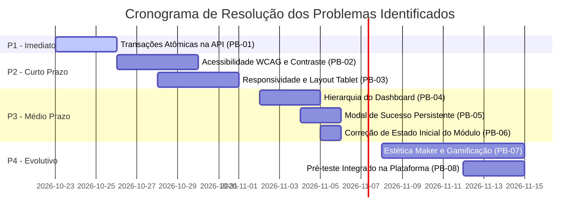

# Matriz Consolidada de Problemas e Plano de Ação
## Sistema: TeacherMakers (v1.0)

**Data de Emissão:** Outubro de 2026  
**Finalidade:** Unificar, categorizar, priorizar e propor soluções definitivas para todas as não conformidades, falhas de usabilidade, vulnerabilidades técnicas e gargalos identificados no ciclo de avaliação da qualidade.

---

### Critérios de Classificação

#### Classificação de Severidade
* 🔴 **Crítica:** Impede a operação correta, compromete a integridade do banco de dados, gera vulnerabilidade de segurança ou bloqueia o avanço do usuário. Correção mandatória antes de qualquer liberação para uso real.
* 🟡 **Alta:** Prejudica seriamente a experiência, gera exclusão de usuários (acessibilidade) ou causa falhas ergonômicas substanciais que aumentam muito o tempo de conclusão.
* 🟢 **Média:** Dificuldade pontual de uso, ruído cognitivo ou incoerência visual com a qual o usuário consegue lidar, mas que causa atrito desnecessário.
* ⚪ **Baixa:** Refinamento cosmético, enriquecimento estético ou limitação metodológica sem impacto direto na estabilidade do software.

#### Classificação de Prioridade de Correção
* **P1 (Imediata):** Bloqueador de lançamento. Deve ser corrigido no ciclo atual de desenvolvimento.
* **P2 (Curto Prazo):** Próxima iteração/sprint prioritária.
* **P3 (Médio Prazo):** Melhoria da versão seguinte.
* **P4 (Backlog / Evolutivo):** Melhoria estética contínua e refinamento metodológico.

---

### Tabela da Matriz Consolidada de Problemas

| ID | Dimensão de Origem | Tela / Componente Afetado | Descrição Detalhada da Falha / Problema | Severidade | Causa Raiz | Impacto no Usuário / Sistema | Ação Recomendada (Solução Proposta) | Prioridade |
| :---: | :--- | :--- | :--- | :---: | :--- | :--- | :--- | :---: |
| **PB-01** | Avaliação Técnica (API / Backend) | Endpoint `/progress/pratica/finish` | **Gravação de registros parciais no banco de dados em requisições anômalas.** Quando a requisição multipart falha na validação de arquivo, partes do payload foram persistidas na base. | 🔴 **Crítica** | Ausência de controle de transação atômica (`BEGIN TRANSACTION / COMMIT / ROLLBACK`) no controlador do backend. | Corrupção da base de dados, risco de progresso indevido ("fantasma") e certificados emitidos sem comprovação válida. | Envolver a operação de persistência da submissão em transação estrita do SQLite/Knex/Prisma. Se o arquivo ou texto falhar, efetuar `ROLLBACK` total. | **P1 (Imediata)** |
| **PB-02** | Acessibilidade (Lighthouse) | Toda a aplicação (Global) | **Pontuação de acessibilidade crítica (Score 50/100).** Contraste deficiente em botões secundários, ausência de `aria-label` e suporte inadequado para foco por teclado. | 🟡 **Alta** | Falta de conformidade estrita com diretrizes WCAG 2.1 AA na folha de estilos e marcação HTML. | Professores com baixa visão ou restrição motora ficam impedidos de navegar e submeter atividades. | Ajustar contraste de cores para razão mínima 4.5:1; adicionar `aria-label` em botões de ícone; definir anéis de foco visíveis (`:focus-visible`). | **P2 (Curto Prazo)** |
| **PB-03** | Inspeção Visual / Usabilidade | Viewport de Tablets (768px a 1024px) | **Incoerência e quebra de layout em tablets.** Grids sobrepostos, campo do diário de bordo desconfortável para digitação no toque, tempo de tarefa dilatado (30 min). | 🟡 **Alta** | Ausência de regras de CSS Media Queries calibradas para a faixa intermediária de tablets. | Usuários de tablets sofrem atraso severo, cometem toques erráticos e sentem desconforto físico na digitação. | Implementar layout responsivo específico para tablets; expandir campos de texto para 100% da largura útil; garantir botões com área de toque $\ge 48\text{px}$. | **P2 (Curto Prazo)** |
| **PB-04** | Inspeção Visual / Usabilidade | Dashboard Principal (Trilha de Módulos) | **Competição de estímulos visuais e hesitação na localização do Módulo 1.** O usuário não sabe de imediato onde clicar para iniciar a jornada. | 🟢 **Média** | Todos os cards de módulos apresentam mesmo peso visual e tamanho; faltam textos de orientação diretos. | Atrito cognitivo no primeiro minuto de acesso; necessidade de cliques exploratórios desnecessários. | Destacar o Módulo 1 com badge "Comece por Aqui" e borda contrastante; esmaecer módulos futuros bloqueados com ícone de cadeado. | **P3 (Médio Prazo)** |
| **PB-05** | Usabilidade / Inspeção Visual | Módulo de Atividades (Feedback de Envio) | **Feedback de sucesso sutil e passageiro após envio da prática.** Notificação toast desaparece em poucos segundos sem ser percebida pelo educador. | 🟢 **Média** | O componente de notificação depende de um timeout curto e não retém o foco visual central do usuário. | Insegurança do cursista quanto à confirmação da atividade; risco de reenvios repetidos por dúvida. | Substituir o toast por um Modal Centralizado de Sucesso com botão "Avançar para o Próximo Módulo" e atualização do progresso em tela. | **P3 (Médio Prazo)** |
| **PB-06** | Teste de Usabilidade | Fluxo de Cadastro e Onboarding | **Módulo introdutório constando como concluído no primeiro login do usuário.** O usuário novo abre a tela e encontra o módulo 0 já finalizado. | 🟢 **Média** | Inicializador de dados de usuário ou migration no banco atribuindo status `completed: true` indevidamente. | Quebra da sequência pedagógica esperada e estranheza relatada pelo participante durante o teste. | Revisar o script de criação de conta no backend para garantir que todos os módulos iniciem com `status: 'locked'` ou `'available'`. | **P3 (Médio Prazo)** |
| **PB-07** | Experiência do Usuário (UEQ-S) | Identidade Visual e Interface Global | **Qualidade Hedônica neutra (+0,31) e percepção de sistema convencional e tradicional.** Falta de dinamismo maker na interface. | ⚪ **Baixa** | Design sóbrio corporativo focado apenas na função, sem microanimações, badges comemorativos ou estética maker. | Menor engajamento emocional a longo prazo; sensação de "apenas cumprir tabela". | Adicionar elementos de gamificação leve (conquistas maker ao concluir cada prática), microinterações de animação e paleta visual mais vibrante. | **P4 (Evolutivo)** |
| **PB-08** | Avaliação Educacional (Metodologia) | Instrumento de Avaliação de Aprendizagem | **Ausência da coleta de pré-teste pareado.** A base registrou apenas 1 resposta no pós-teste, impedindo o cálculo formal do Teste T de Student. | ⚪ **Baixa (Metod.)** | Falha de execução no protocolo de coleta de dados em campo, onde o link de pré-teste não foi aplicado antes das aulas. | Limitação do rigor acadêmico formal; evidência permanece apenas no âmbito descritivo e qualitativo. | Integrar o formulário de diagnóstico pedagógico obrigatoriamente dentro da plataforma, antes da liberação da Aula 1. | **P4 (Metodológico)** |

---

### Cronograma de Resolução e Recomendações Priorizadas

---

### Síntese de Responsabilidades

| Papel | Itens sob Responsabilidade | Entregável Esperado |
| :--- | :--- | :--- |
| **Desenvolvedor Back-end** | PB-01, PB-06, PB-08 | Transações atômicas com rollback no endpoint de submissão; correção da inicialização do usuário; endpoint de pré-teste integrado. |
| **Desenvolvedor Front-end / UI** | PB-02, PB-03, PB-04, PB-05, PB-07 | Correção de contraste e atributos ARIA; media queries para tablet; modal persistente de sucesso; redesign do dashboard. |
| **Pesquisador Pedagógico** | PB-07, PB-08 | Roteiro de gamificação formativa; aplicação de nova bateria de pré/pós-teste pareada com coorte de 15+ professores. |
