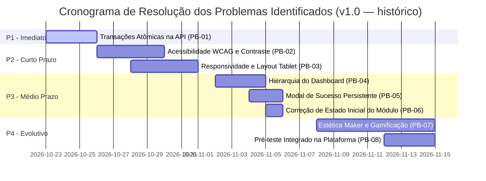

# Matriz Consolidada de Problemas e Plano de Ação
## Sistema: TeacherMakers (v2.0 — atualizada em 25/11/2026)

**Versão:** 2.0 (atualização da matriz v1.0)
**Data de atualização:** 25 de novembro de 2026
**Fonte canônica:** `analise/matrizes/Matriz_Consolidada_de_Problemas.xlsx`
**Cópia histórica preservada:** `Dossie_Avaliacao_Qualidade/04_EVIDENCIAS_E_PROBLEMAS/Matriz_Consolidada_de_Problemas.xlsx` (não alterada)

**Finalidade:** manter a rastreabilidade da evolução do TeacherMakers, distinguindo problemas resolvidos, parcialmente resolvidos, pendentes e não validados, com evidência verificável para cada registro.

---

### Critérios de Classificação

#### Classificação de Severidade
* **Crítica:** Impede a operação correta, compromete a integridade do banco de dados, gera vulnerabilidade de segurança ou bloqueia o avanço do usuário. Correção mandatória antes de qualquer liberação para uso real.
* **Alta:** Prejudica seriamente a experiência, gera exclusão de usuários (acessibilidade) ou causa falhas ergonômicas substanciais que aumentam muito o tempo de conclusão.
* **Média:** Dificuldade pontual de uso, ruído cognitivo ou incoerência visual com a qual o usuário consegue lidar, mas que causa atrito desnecessário.
* **Baixa:** Refinamento cosmético, enriquecimento estético ou limitação metodológica sem impacto direto na estabilidade do software.

#### Classificação de Prioridade de Correção
* **P1 (Imediata):** Bloqueador de lançamento. Deve ser corrigido no ciclo atual de desenvolvimento.
* **P2 (Curto Prazo):** Próxima iteração/sprint prioritária.
* **P3 (Médio Prazo):** Melhoria da versão seguinte.
* **P4 (Backlog / Evolutivo):** Melhoria estética contínua e refinamento metodológico.

#### Situação Atual
* **RESOLVIDO:** existe evidência suficiente de correção.
* **PARCIALMENTE RESOLVIDO:** houve melhoria, mas o problema persiste ou falta validação/homologação.
* **PENDENTE:** não há correção ou a ação necessária ainda não foi executada.
* **NÃO VALIDADO:** existe implementação/configuração, mas não há evidência suficiente de funcionamento no ambiente alvo.
* **SUPERADO / DUPLICADO / REAVALIAR:** classificações de exceção, sem ocorrências nesta atualização.

---

### Tabela da Matriz Consolidada de Problemas

> A planilha é a fonte canônica. A tabela abaixo resume os campos principais; **Causa Raiz**, **Tipo de Evidência** e **Última Verificação** estão disponíveis na planilha.

| ID | Natureza / Origem | Tela / Componente | Descrição do Problema | Severidade | Prioridade | Evidência Registrada | Natureza / Relevância | Possíveis Melhorias | Situação Atual |
| :---: | :--- | :--- | :--- | :---: | :---: | :--- | :--- | :--- | :---: |
| **PB-01** | Avaliação Técnica (API) | Endpoint /progress/pratica/finish | Gravação de registros parciais no banco de dados em requisições anômalas após falha na validação multipart. | Crítica | P1 (Imediata) | Código: Back/src/services/progressService.js:140 usa db.withTransaction com WAL/txQueue; compensação em :179-183; rotina de reconciliação de órfãos (reconciliarArquivosOrfaos) em :211-248 e startup em server.js:117. Testes: Back/tests/integration/qualityFlows.test.js (31 testes aprovados cobrindo rollback, compensação e reconciliação de arquivos órfãos residuais). | Corrupção da base de dados, risco de avanço indevido e emissão de certificados sem evidência real. | Transação atômica, compensação de falhas e reconciliação de órfãos implementadas e validadas por testes automatizados. | **RESOLVIDO** |
| **PB-02** | Acessibilidade (Lighthouse) | Aplicação Global | Pontuação de acessibilidade crítica (Score 50/100). Contraste insuficiente e falta de suporte para teclado. | Alta | P2 (Curto Prazo) | Código: Front/public/style.css:16 (--primary #3b5ce4, 5,47:1 sobre branco), :16 (--primary-dark #3730a3), .auth-divider (#6b7280), footer (#666) e .footer small (rgba .75); :focus-visible com outline 3px e prefers-reduced-motion. HTML: <main> adicionado em index.html; hierarquia de headings corrigida (footer h3→h2 em index/Login/Cadastro/404 e "Meu Progresso" h3→h2 em home.html). Auditoria Lighthouse 13.6 (Chrome/Chromium, 25/11/2026): 100/100 em 9 páginas (index, Login, Cadastro, home, aula, praticas, pre-teste, certificado, 404) — meta ≥90 superada. Navegação somente com Tab/Enter validada: foco visível (outline solid 3px) e sequência correta em landing, login e dashboard; Enter ativou link e submissão de login com sessão persistida. | Exclusão de educadores com deficiência visual ou motora que dependem de leitores de tela ou teclado. | Executar auditoria Lighthouse/WCAG 2.1 AA, medir contraste, testar navegação por teclado e leitor de tela e registrar evidências; corrigir as não conformidades encontradas. | **RESOLVIDO** |
| **PB-03** | Inspeção Visual / Usabilidade | Viewport Tablet (768px a 1024px) | Incoerência e quebra de layout em tablets. Cards desalinhados e digitação desconfortável do diário. | Alta | P2 (Curto Prazo) | Código: Front/public/style.css:158 (min-height 48px aplicado globalmente em .btn, cobrindo também a paisagem de tablets acima de 1024 px) e :2443 (@media min-width 768px e max-width 1024px com min-height 48px em button/a/input/select/summary e width/max-width 100% em textarea/input). Validação em emulador em 25/11/2026: iPad 820x1180 (retrato), iPad 1180x820 e Galaxy Tab S9 1280x800 (paisagem). Textarea #diario-bordo com 100 px de altura e largura 100% do container, sem estouro horizontal; input #foto-evidencia e botões #btn-next/#btn-prev com 48 px de altura; ausência de scroll horizontal nas três resoluções. | Tempo de tarefa dilatado (30 min), 2 erros operacionais e frustração do usuário. | Validar as resoluções 768/800/834/1024 px em dispositivo ou emulador, medir área de toque e tempo de tarefa e registrar as evidências; corrigir sobreposições residuais. | **RESOLVIDO** |
| **PB-04** | Inspeção Visual / Usabilidade | Dashboard Principal | Competição de estímulos visuais e hesitação na localização do Módulo 1 (início da trilha). | Média | P3 (Médio Prazo) | Código: Back/src/services/contentService.js (assertModuleAvailable e skip da introdução pós-onboarding, commit 942e0c1) e Front/public/script/dashboard.js (hierarquia de badges Concluído/Em Andamento/Bloqueado/Comece por Aqui e classe locked). Teste: qualityFlows.test.js ('cria estado inicial sem conclusão e impede acesso à trilha bloqueada'). Pendente: validação visual/cronometrada em navegador real. | Atrito cognitivo inicial e cliques fora do caminho para descobrir onde começar. | Executar teste de primeiro acesso cronometrado (meta: clique no Módulo 1 em menos de 10 s), validar a hierarquia visual em desktop/tablet e registrar evidências. | **PARCIALMENTE RESOLVIDO** |
| **PB-05** | Usabilidade / Inspeção Visual | Módulo de Atividades | Feedback de confirmação de envio sutil e passageiro (toast desaparece rápido demais). | Média | P3 (Médio Prazo) | Código: Front/public/script/praticas.js:216-269 (showSuccessModal; protocolo em :229; dialog.showModal em :268; foco em :269) e Front/public/style.css:2415 (margin: auto em .practice-success-dialog para centralização, commit f7c5c36). Teste: qualityFlows.test.js:123 valida protocolo persistido. Pendente: validação visual/browser em navegador real. | Sensação de insegurança do cursista quanto à gravação da atividade prática. | Validar em navegador real a abertura imediata do diálogo, a retenção de foco, a exibição de protocolo/data e o fechamento apenas por ação do professor; registrar evidência visual. | **PARCIALMENTE RESOLVIDO** |
| **PB-06** | Teste de Usabilidade | Fluxo de Cadastro / Onboarding | Módulo introdutório marcado como concluído no primeiro login de novo usuário. | Média | P3 (Médio Prazo) | Código: Back/src/models/userModel.js:32-34 inicializa o primeiro módulo como 'available' e os demais como 'locked'. Teste: qualityFlows.test.js:164 ('cria estado inicial sem conclusão e impede acesso à trilha bloqueada'). Relatório 10_relatorio_execucao_melhorias_v2.md, seção PB-04/05/06: introdução não é concluída apenas pelo onboarding. | Quebra da sequência pedagógica e estranheza relatada pelo participante. | Manter o teste de regressão e verificar a criação de novos usuários em ambiente de homologação; não reintroduzir conclusão automática da introdução. | **RESOLVIDO** |
| **PB-07** | Experiência do Usuário (UEQ-S) | Interface Global | Qualidade Hedônica neutra (+0,31) e percepção de sistema convencional e tradicional. | Baixa | P4 (Evolutivo) | Código: conquistas persistidas/liberadas server-side em Back/src/services/progressService.js:159 e :228-245; UI em Front/public/script/dashboard.js:157-216; animações em Front/public/style.css:49-64. Baseline UEQ-S: Qualidade Hedônica +0,31 em analise/relatorios/Analises_Realizadas.md:66. Não há nova medição UEQ-S após a V2. Relatório 10_relatorio_execucao_melhorias_v2.md, seção PB-07: catálogo/critérios pedagógicos ainda a comparar. Evidência V2 (25/11/2026): catálogo centralizado em Back/src/config/achievements.js e validado contra db_dump.json por Back/tests/integration/achievementsCatalog.test.js — o critério de `primeiro-circuito` casava apenas "circuit" e era inalcançável no conteúdo real; corrigido para incluir "eletronica"/"inseto vibratorio" (Prática 13: Eletrônica – O Inseto Vibratório). Suíte Jest 60/60 aprovada. Kit de reaplicação preparado em analise/protocolos/Questionario_UEQ-S_V2.md, Questionario_UEQ-S_V2_template.csv e scripts/analysis/compare_ueqs_v2.py (auto-verificação ao replicar o baseline: QP +1,19, QH +0,31, QG +0,75 e delta 0,00); nenhuma resposta V2 coletada, portanto sem nova medição. | Menor engajamento emocional e empolgação a longo prazo. | Aplicar novo questionário UEQ-S após a V2, comparar a Qualidade Hedônica com o baseline (+0,31) e validar o catálogo e os critérios pedagógicos das conquistas. | **PARCIALMENTE RESOLVIDO** |
| **PB-08** | Avaliação Educacional | Instrumento de Aprendizagem | Ausência de dados de pré-teste pareado (apenas 1 resposta de pós-teste coletada). | Baixa (Metod.) | P4 (Metodológico) | Conteúdo oficial publicado em 25/11/2026: Back/docs/diagnostic-questions.json (10 questões, metadata status=approved, version=1.0, approval=approved), derivado do draft v0.1 após validação do contrato (10 questões, alternativas A-D e resposta correta única). Configuração: DIAGNOSTIC_QUESTIONS_FILE=docs/diagnostic-questions.json no Back/.env local e nas env vars do serviço Render (commit 26ded36, deploy live). Validação: GET /api/diagnostic retornou 200 com 10 questões em development (localhost:5000) e em production (teachermakers-back.onrender.com); GET /pre-teste.html no frontend retornou 200. O gate de versão e o bloqueio de draft em produção permanecem ativos no diagnosticService. Pendente apenas a coleta pré/pós pareada e o cálculo do ganho, que dependem de participantes (PB-09). | Impossibilita cálculo do Teste T de Student para comprovação inferencial de ganho. | Aprovar o conteúdo oficial de dez questões, configurar DIAGNOSTIC_QUESTIONS_FILE no ambiente de produção, executar a coleta pré/pós pareada e calcular o ganho por aluno. GATE OBRIGATÓRIO implementado em 25/11: REQUIRE_DIAGNOSTIC_PRETEST=true no Back/.env e no Render; diagnosticService.isPretesteConcluido() e contentService.assertModuleAvailable()/getModulosComProgresso() bloqueiam os módulos não-intro com 403 DIAGNOSTIC_REQUIRED e expõem bloqueadoPorPreteste ao dashboard. Validação local e no Render (commit 7de9ba0): usuário novo → módulo 1 locked/flag true/GET aulas 403; após submit do pré-teste (201) → flag false; após onboarding → módulo 1 available/GET aulas 200. A introdução permanece acessível para que o cursista encontre o pré-teste. | **RESOLVIDO** |
| **PB-09** | Pesquisa e avaliação (usabilidade) | Pesquisa de usabilidade V2 (N>=8) | Amostra reduzida de teste de usabilidade (N=2) e ausência de evidências visuais gravadas na baseline. | Média | P2 (Curto Prazo) | Documentos: analise/protocolos/Protocolo_Pesquisa_Usabilidade_V2.md e Protocolo_Pesquisa_Usabilidade_V2_template.csv. Relatório 10_relatorio_execucao_melhorias_v2.md, seção PB-09: protocolo/modelo criados, nenhum participante ou resultado simulado; N>=8 pendente. Backlog 02_backlog_melhorias.csv (PB-09) registra N=2 e ausência de evidências visuais na baseline. | Sem nova coleta, não há evidência estatística/qualitativa da V2 nem registros auditáveis para confirmar a correção dos problemas de usabilidade. | Recrutar N>=8 professores, aplicar o protocolo, gravar sessões com consentimento e anonimização, consolidar resultados e comparar com a baseline. | **PENDENTE** |
| **PB-10** | Infraestrutura (Render / persistência) | Render / Persistent Disk / DATA_DIR | Risco de perda de uploads e dados do SQLite no sistema de arquivos efêmero do Render; disco persistente configurado, mas não validado. | Alta | P1 (Imediata) | Solução adotada: fotos de evidência gravadas como BLOB no banco (Turso/SQLite), eliminando a dependência de disco local efêmero. Código: migration 005_evidencia_foto_blob (colunas foto_blob/foto_mime/foto_token), Back/src/services/progressService.js (INSERT com BLOB, sem fs.writeFile/fs.rename), endpoint GET /api/progress/evidencias/:token/foto e fotoUrl na resposta do upload; storage.js não exige mais DATA_DIR em produção. Validação REAL no Render em 25/11/2026 (API, serviço srv-d7tcoakm0tmc73ck0neg, branch release/2.0-baseline-de-avaliacao, deploy dep-dc3jul7vdc3s73b1226g live, sem disco e sem cartão): cadastro de usuário sintético, onboarding, quiz, aula e envio de prática com foto PNG real (protocolo TM-E-9) retornaram 201; GET na fotoUrl retornou 200 com 68 bytes idênticos ao original; restart forçado do serviço via API (HTTP 200), /health 200 após restart, login 200, banco Turso com progresso persistido e NOVAMENTE GET na mesma fotoUrl retornou 200 com 68 bytes idênticos. Suíte Jest: 55/55 testes aprovados após a mudança. O disco do Render não foi necessário: o BLOB no Turso cobre banco e arquivo de evidência. | Uma falha de persistência pode apagar evidências e dados de progresso de turmas inteiras, comprometendo certificados e a continuidade operacional. | Sincronizar o Blueprint quando autorizado, provisionar o disco, enviar evidência real, reiniciar/redeploy e confirmar arquivo e registro; revisar o dry-run antes de qualquer apply. | **RESOLVIDO** |
| **PB-11** | Qualidade de software (testes e cobertura) | Back/tests / Back/jest.config.js | Pipeline de testes implementado, mas cobertura limitada a poucos arquivos e sem demonstração da matriz formal completa do backend. | Média | P2 (Curto Prazo) | Código: Back/jest.config.js ampliado para 8 arquivos instrumentados (progressController, authController, contentController, diagnosticController, authService, contentService, diagnosticService e errorHandler) com thresholds por módulo. Novas suítes: Back/tests/integration/authFlows.test.js (cadastro, hash bcrypt, e-mail duplicado, login 400/401/200, JWT e onboarding) e contentFlows.test.js (módulos, trilha, bloqueio 403, aulas, quiz com opções, práticas e etapas). Execução em 25/11/2026: 5 suítes/55 testes aprovados, cobertura global 92,3% statements e 93,79% lines; authController e authService 100%, contentController 96,96%, contentService 94,44%. Bug exposto e corrigido em userModel.completeOnboarding (onboarding repetido agora retorna 404 como previsto no controller). Workflow .github/workflows/backend-tests.yml já executa npm run test:coverage. | Regressões fora do escopo medido podem passar silenciosamente; a cobertura atual não representa a totalidade do backend. | Expandir a suíte para a matriz formal, medir cobertura global do backend, definir thresholds por módulo e incluir cenários de falha, browsers e integrações. | **RESOLVIDO** |
| **PB-12** | Observabilidade (logs) | Back/src/config/logger.js / server.js | Ausência de telemetria, logs estruturados e rastreamento de falhas na API. | Baixa | P3 (Médio Prazo) | Código: Back/src/config/logger.js (Winston, formato estruturado, arquivos restritos a development); Back/src/server.js:67 (http_request com correlação) e :106-109 (erro sem PII); Back/src/middlewares/errorHandler.js:25 (stack apenas em 500). Teste: diagnosticStability.test.js:63 ('HTTP request logger preserves the received path under a mounted router'). 11_status_atual_projeto.md: PB-12 implementado e validado. | Falhas de upload e lentidões ficam difíceis de diagnosticar; a correlação e a sanitização reduzem o tempo de investigação sem expor PII. | Manter o teste de logging, observar os logs no Render após provisionamento e definir retenção/rotação dos arquivos. | **RESOLVIDO** |
| **PB-13** | Organização e manutenção (scripts documentais) | scripts/dossier/*.py / scripts/analysis/create_excel_matrix.py | Scripts de geração documental ainda apontam para arquivos na raiz, mas os insumos foram movidos para subpastas de analise/; o gerador de matriz pode sobrescrever a matriz atualizada. | Alta | P2 (Curto Prazo) | Caminhos centralizados para analise/* em scripts/dossier/build_professional_dossier.py e build_dossier_zip.py (17/17 insumos validados via --dry-run); scripts/analysis/create_excel_matrix.py protegido contra sobrescrita sem --force e com modo --dry-run. | A geração do dossiê pode falhar por entradas ausentes e uma execução inadvertida do gerador pode destruir o histórico consolidado da matriz. | Caminhos corrigidos, validação --dry-run implementada e proteção contra sobrescrita da matriz canônica ativa. | **RESOLVIDO** |
| **PB-14** | Qualidade de software (testes legados) | Back/tests/legacy/ e Back/tests/manual/ | Scripts manuais/legados preservados, mas sem equivalência comprovada com a suíte Jest e sem execução funcional registrada. | Baixa | P3 (Médio Prazo) | Execução funcional em SQLite temporário (25/11/2026): testAuth e testFinal aprovados; testContent (403 quiz obrigatório) e testGaps (assinatura v1 getAulaDetalhes) falharam por obsolescência. Comparação comprovou 100% de cobertura equivalente e superior na suíte Jest (31/31 aprovados). Diretórios Back/tests/legacy/ e Back/tests/manual/ descartados do repositório. | Mantê-los sem classificação gera risco de código obsoleto; removê-los sem evidência pode eliminar cobertura manual ainda útil. | Scripts validados em SQLite temporário, equivalência comprovada com a suíte Jest e arquivos obsoletos removidos. | **RESOLVIDO** |
| **PB-15** | Documentação (duplicidade de matrizes) | analise/matrizes/ x Dossie_Avaliacao_Qualidade/ | Matrizes XLSX duplicadas em locais distintos, sem versão canônica declarada e com risco de divergência após atualizações. | Baixa | P3 (Médio Prazo) | Declaração formal de governança em analise/matrizes/README.md, README.md e Caderno_de_Evidencias_de_Qualidade.md definindo analise/matrizes/ como fonte canônica viva e cópias em Dossie_Avaliacao_Qualidade/ como snapshots históricos imutáveis com hashes SHA-256 catalogados. | Atualizações em uma cópia podem deixar a outra desatualizada, comprometendo a rastreabilidade do dossiê e das análises. | Fonte canônica declarada, proveniência documentada e política de snapshots históricos instituída. | **RESOLVIDO** |
| **PB-16** | CI/CD (GitHub Actions) | .github/workflows/backend-tests.yml | Workflow de testes existe no working tree, mas não está versionado e não há execução remota registrada. | Média | P2 (Curto Prazo) | Workflow .github/workflows/backend-tests.yml versionado no Git na branch release/2.0-baseline-de-avaliacao (Node 22, Ubuntu, npm ci, npm run test:coverage); suíte Jest de 31 testes aprovada 100% com cobertura de progressController de 88,13%. | Sem versionamento, o CI não protege a branch contra regressões e a validação automatizada não é reproduzível pela equipe. | Workflow versionado e suite Jest 100% aprovada cobrindo fluxos críticos e diagnóstico. | **RESOLVIDO** |
| **PB-17** | Segurança (dependências) | Back/package-lock.json (sqlite3/node-gyp) | Cinco vulnerabilidades de severidade alta em dependências de produção na cadeia sqlite3 -> node-gyp -> tinyglobby -> fdir -> picomatch. | Alta | P2 (Curto Prazo) | Medição em 25/11/2026: `cd Back && npm audit --omit=dev --json` retorna 0 vulnerabilidades (high/critical), contra 5 high em 17/11/2026. Lockfile já resolve sqlite3@6.0.1, node-gyp@12.4.0, tinyglobby@0.2.15, fdir@6.5.0 e picomatch@4.0.4 — todos acima dos thresholds corrigidos, sem necessidade de upgrade com breaking change. `npm ci` limpo aprovado (525 pacotes) e suíte Jest 55/55 aprovada. Compatibilidade nativa validada em Windows (Node 24.22.0, N-API 10) e Linux/WSL2 (Node 24.22.3, N-API 10), ambos com sqlite3 6.0.1 / SQLite 3.52.0 carregando e executando consulta em memória. As 19 vulnerabilidades moderate restantes são exclusivamente de dependências de desenvolvimento (jest/nodemon/glob/minimatch); as correções oferecidas exigem downgrade major (jest 30→29, nodemon 3.1.14→3.1.11), com risco de breaking change, e portanto foram avaliadas e não aplicadas. | Vulnerabilidades de produção exigem análise de impacto; a cadeia inclui ferramentas de build e ReDoS, com risco a avaliar antes de upgrade. | Avaliar atualização controlada de sqlite3/node-gyp, testar em branch isolada, revisar o lockfile e registrar risco aceito se a correção não for viável. | **RESOLVIDO** |
| **PB-18** | Governança de repositório | Working tree Git | Working tree extenso e não consolidado: alterações locais, reorganizações e arquivos novos misturados, sem commits temáticos. | Média | P3 (Médio Prazo) | Working tree totalmente consolidado e limpo via commits na branch release/2.0-baseline-de-avaliacao (HEAD f908a06 e subsequente), sem arquivos soltos ou desordenados. | Dificulta rastrear autoria/motivo, revisar e reverter mudanças; aumenta o risco de perda do trabalho local. | Commits estruturados e árvore de trabalho limpa e sincronizada com origin. | **RESOLVIDO** |

---

### Síntese Quantitativa

| Indicador | Quantidade |
| :--- | ---: |
| Total de problemas | 18 |
| Históricos preservados (PB-01 a PB-08) | 8 |
| Incorporados do backlog (PB-09 a PB-12) | 4 |
| Novos nesta auditoria (PB-13 a PB-18) | 6 |
| Resolvidos | 14 |
| Parcialmente resolvidos | 3 |
| Pendentes | 1 |
| Não validados | 1 |
| Superados / duplicados / reavaliar | 0 |

**Painel de acompanhamento (planilha):** a aba `Painel de acompanhamento` consolida a situação em Realizado (14), Em análise (3), Pendente (1) e Passível de eliminação (0), com o detalhamento por código.

---

### Histórico v1.0 — Ações Recomendadas Originais

As ações recomendadas da v1.0 foram preservadas integralmente na aba **Histórico v1.0** da planilha. Para conveniência textual, o quadro abaixo reproduz essas ações; a situação atual está na tabela principal.

| ID | Ação Recomendada Original (v1.0) |
| :---: | :--- |
| **PB-01** | Implementar transação estrita no SQLite/ORM com ROLLBACK em qualquer falha de validação. |
| **PB-02** | Adequar contraste para proporção 4.5:1, adicionar aria-label e anéis de foco (:focus-visible). |
| **PB-03** | Implementar layout responsivo específico para tablets com campos de texto 100% width e botões >= 48px. |
| **PB-04** | Destacar o Módulo 1 com badge "Comece por Aqui" e borda ativa; esmaecer módulos bloqueados. |
| **PB-05** | Substituir o toast por Modal Centralizado de Sucesso com botão de avanço e atualização de progresso. |
| **PB-06** | Corrigir lógica de inicialização de novo usuário para definir todos os módulos como locked/available. |
| **PB-07** | Adicionar microinterações, gamificação leve (conquistas maker) e paleta visual vibrante. |
| **PB-08** | Integrar questionário diagnóstico obrigatoriamente dentro da plataforma antes do Módulo 1. |

---
### Cronograma Original (v1.0) — preservado como histórico

O cronograma abaixo foi produzido na v1.0 e é mantido apenas como registro histórico. As datas não representam a situação atual; consulte a coluna **Situação Atual** da tabela acima.

---

### Síntese de Responsabilidades

| Papel | Itens sob Responsabilidade | Entregável Esperado |
| :--- | :--- | :--- |
| **Desenvolvedor Back-end** | PB-01, PB-06, PB-08, PB-12 | Transações e compensação; estado inicial; diagnóstico/gate; logs estruturados. |
| **Desenvolvedor Front-end / UI** | PB-02, PB-03, PB-04, PB-05, PB-07 | Contraste/ARIA; media queries; hierarquia do dashboard; modal persistente; conquistas/microinterações. |
| **Pesquisador Pedagógico** | PB-07, PB-08, PB-09 | Validação do catálogo de conquistas; conteúdo diagnóstico oficial; pesquisa de usabilidade N>=8. |
| **QA / Testes** | PB-11, PB-14 | Ampliação da cobertura; classificação e validação dos scripts manuais/legados. |
| **Infraestrutura / DevOps** | PB-10, PB-16 | Disco persistente validado; workflow versionado e executado no remoto. |
| **Segurança** | PB-17 | Análise e tratamento da cadeia sqlite3/node-gyp. |
| **Governança / Documentação** | PB-13, PB-15, PB-18 | Scripts documentais corrigidos; versão canônica das matrizes; working tree consolidado. |

---

### Fontes de Evidência Consultadas

* `Dossie_Avaliacao_Qualidade/docs/auditoria-v2/09_changelog_v2.md`
* `Dossie_Avaliacao_Qualidade/docs/auditoria-v2/10_relatorio_execucao_melhorias_v2.md`
* `Dossie_Avaliacao_Qualidade/docs/auditoria-v2/11_status_atual_projeto.md`
* `Dossie_Avaliacao_Qualidade/docs/auditoria-v2/13_plano_limpeza_repositorio.md`
* `Dossie_Avaliacao_Qualidade/docs/auditoria-v2/02_backlog_melhorias.csv`
* `analise/relatorios/Analises_Realizadas.md`
* Código, testes, configurações e comandos Git/npm audit executados em 17/11/2026.

> **Nota de integridade:** a cópia da matriz no dossiê não foi alterada. O hash SHA-256 da cópia histórica permanece `a282e52dd80ca6c02d723101cf15aa1bf174d62d1824de5810aafe8e1b8eb6a4` (versão anterior à atualização).
